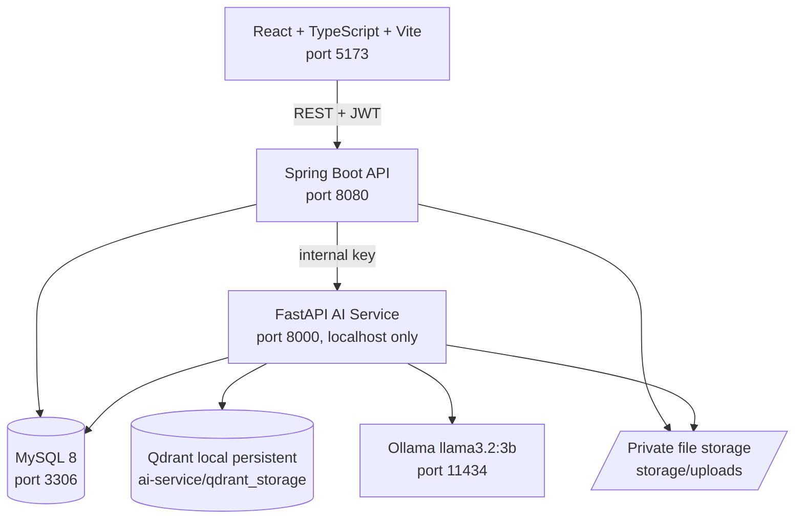
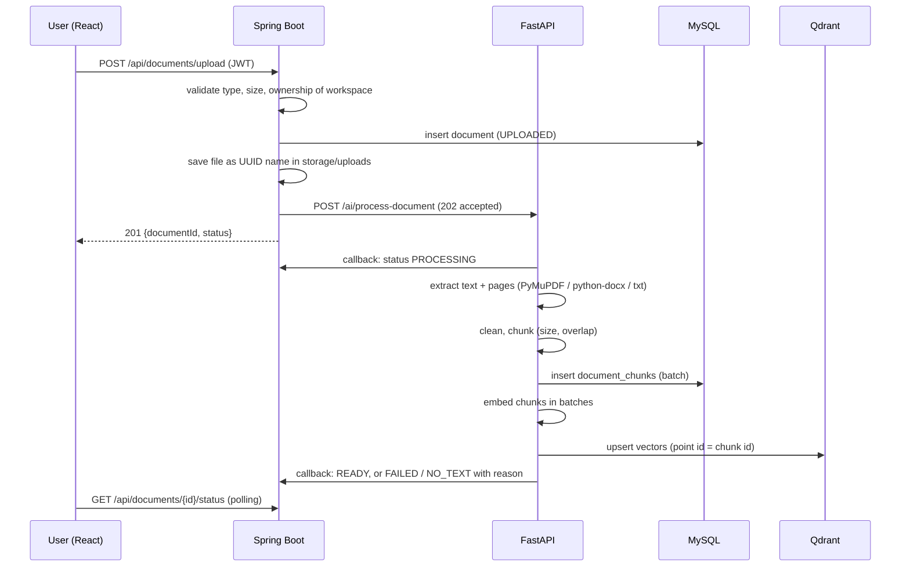
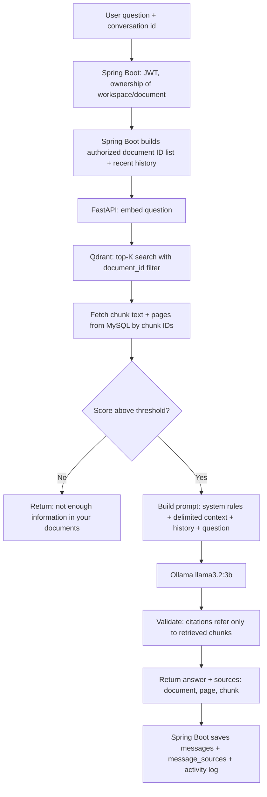

# DocuMind AI: Architecture

Version: 0.1 (draft)
Related documents: [SRS.md](SRS.md), [ER_DIAGRAM.md](ER_DIAGRAM.md), [PROJECT_PLAN.md](PROJECT_PLAN.md)

---

## 1. System architecture



### 1.1 Responsibilities

| Component | Owns |
|---|---|
| React | UI only. No security decisions |
| Spring Boot | Authentication, authorization, ownership checks, users, workspaces, document metadata and status, conversations, messages, analytics, admin, file upload and storage, **the database schema (Flyway migrations)** |
| FastAPI | Text extraction, cleaning, chunking, embeddings, Qdrant read/write, retrieval, RAG prompt, Ollama calls, summaries, quiz and flashcard generation |
| MySQL | Source of truth for all application data and chunk text |
| Qdrant | Vectors plus small search payload only |
| Ollama | Text generation |

### 1.2 Data ownership rules

These rules prevent inconsistent records between the two services and the two databases.

- **Spring Boot is the only service that creates or changes the schema** (Flyway). FastAPI never runs DDL.
- **Spring Boot writes** users, workspaces, documents (including `status`), conversations, messages, message_sources, generated_content and activity_logs.
- **FastAPI writes only** `document_chunks` (insert, delete) and Qdrant points. It reads files from the shared storage folder.
- Document status changes are reported by FastAPI to Spring Boot through an internal endpoint, so Spring Boot stays the single writer of `documents.status`.
- FastAPI receives only **already-authorized IDs** from Spring Boot (user, workspace, list of allowed document IDs). It never decides who may see what.

### 1.3 Why MySQL and Qdrant are used together

MySQL is good at relational data, transactions, ownership and exact lookups. It is not designed for fast nearest-neighbor search over embeddings. Qdrant is built for that and supports metadata filters. So Qdrant answers "which chunks are most similar?" and returns chunk IDs; MySQL then supplies the real text and page numbers. Text is stored once (in MySQL) and vectors once (in Qdrant).

### 1.4 Internal service security

- FastAPI binds to `127.0.0.1` only.
- Every Spring Boot to FastAPI request carries an `X-Internal-Key` header (a long random value from `.env`). FastAPI rejects requests without it.
- The callback from FastAPI to Spring Boot uses the same mechanism on a separate internal endpoint that is not reachable from the frontend.

### 1.5 Qdrant local-mode limitation

Qdrant's local mode locks its storage folder, so **only one process can open it**. The AI service therefore runs **one uvicorn worker** (no `--workers N`, no second instance). Local mode is also slower on large collections and lacks some server features. This is acceptable for a portfolio project; the optional migration to a Qdrant server removes the limit.

---

## 2. Qdrant collection design

| Setting | Value |
|---|---|
| Collection | `document_chunks` |
| Vector size | 384 (all-MiniLM-L6-v2). Must change if the embedding model changes |
| Distance | Cosine |
| Point ID | `document_chunks.id` from MySQL (integer) |
| Mode | Local persistent, path `ai-service/qdrant_storage` |

Payload per point (identifiers only, no text):

```json
{
  "chunk_id": 1042,
  "user_id": 7,
  "workspace_id": 3,
  "document_id": 55,
  "page_number": 12,
  "chunk_index": 4
}
```

Rules:

- Every search uses a filter `document_id IN (authorized IDs from Spring Boot)`, plus `workspace_id` when relevant. Payload alone is **not** the authorization source; Spring Boot decides the allowed IDs and re-verifies results.
- Using the MySQL chunk ID as the point ID means retrieval returns IDs and the text is fetched with `SELECT ... WHERE id IN (...)`.
- If the embedding model changes, create a **new collection** (for example `document_chunks_bge_small`) and re-index. Never mix vector dimensions.
- Deleting a document deletes its points by `document_id` filter.

---

## 3. Document processing (indexing) flow



**Failure handling.** If any stage fails, FastAPI removes the partial chunks and vectors for that document (compensating cleanup), reports `FAILED` with a message, and the user can press **Retry**. Retry is idempotent: it deletes old chunks and vectors first, then re-creates them.

---

## 4. Question answering (RAG) flow



### 4.1 Prompt-injection and hallucination safeguards

- Retrieved chunks are placed inside clearly delimited blocks (for example `<context id="12" doc="..." page="3"> ... </context>`), and the system prompt states that text inside context blocks is untrusted data, never instructions.
- The model is told to answer only from context, to say when the context is insufficient, and to cite by context id.
- **Citations are built by our code, not by the model.** The sources returned to the user are the retrieved chunks that were actually passed in. Any chunk id the model mentions that was not retrieved is dropped. Page numbers come only from MySQL.
- A similarity threshold triggers the "insufficient information" answer without calling the LLM, which saves time and avoids invention.
- Document text is never executed or rendered as HTML in the UI. Output is escaped or sanitized markdown.
- **Limitation:** with a 3B-parameter model these safeguards reduce, but do not eliminate, prompt-injection and hallucination risk. The evaluation measures this rather than assuming it.

---

## 5. Deleting and re-indexing

Delete order for a document:

1. Mark the document `DELETING` in Spring Boot (blocks new use).
2. Delete Qdrant points by `document_id`.
3. Delete `document_chunks`.
4. Delete the file from storage.
5. Delete the `documents` row.

If a step fails, the document stays in a retryable state. A **consistency check** (planned for Days 26-27) finds orphans in either store and reports them. Deleting a workspace repeats this process for each of its documents.

---

## 6. Technical facts that shape the design and experiments

1. **all-MiniLM-L6-v2 has a maximum input length of 256 tokens.** Longer text is silently truncated before embedding. Chunk sizes above 256 tokens would therefore mostly embed only their first part. Experiment 1 will either compare MiniLM at smaller chunk sizes plus a longer-context embedding model (for example `bge-small-en-v1.5` or `nomic-embed-text`), or use the longer-context model for the 300/500/800 comparison. Exact model limits will be confirmed on the development machine before running the experiment.
2. **llama3.2:3b has a limited context window**, and Ollama's default `num_ctx` has historically been small. The `num_ctx` option is set explicitly in every request (`OLLAMA_NUM_CTX`), and chunk size, top-K and history length are tuned together.
3. **One uvicorn worker only**, because of the Qdrant local-mode lock.

---

## 7. Hardware and performance notes (i5-1335U, 16 GB, no GPU)

- llama3.2:3b on CPU: roughly 10-40 seconds per answer is expected. Streaming can improve perceived speed later.
- Embeddings are generated in batches (starting at 32) with progress logged. Indexing speed will be measured, not guessed.
- Memory: Ollama (about 3-4 GB while loaded), embedding model (about 0.5 GB), MySQL, Spring Boot (limited with `-Xmx512m`), Node dev server and IDE all share 16 GB.
- Large PDFs are processed page by page. The whole document and all vectors are never held in memory at once.
- Long-document summaries and quizzes use a map-reduce style (summarize sections, then summarize the summaries) because of the small context window.

---

## 8. Security overview

- BCrypt password hashing; short-lived access token (about 15 minutes); refresh token stored **hashed** in MySQL and revocable on logout.
- Refresh token delivered in an httpOnly cookie; access token kept in memory by the frontend.
- Role checks on admin endpoints; ownership checks in the service layer for every workspace, document and conversation access. Another user's resource returns 404, not 403.
- Upload validation by extension **and** content signature, allowed types PDF/DOCX/TXT, 25 MB limit, random UUID filenames on disk, files stored outside the frontend folder and served only through an authorized endpoint.
- CORS limited to the frontend origin; rate limiting on login and AI endpoints.
- Secrets only in `.env` (git-ignored); `.env.example` is committed.
- FastAPI bound to localhost with an internal key; the MySQL application user is not root.
