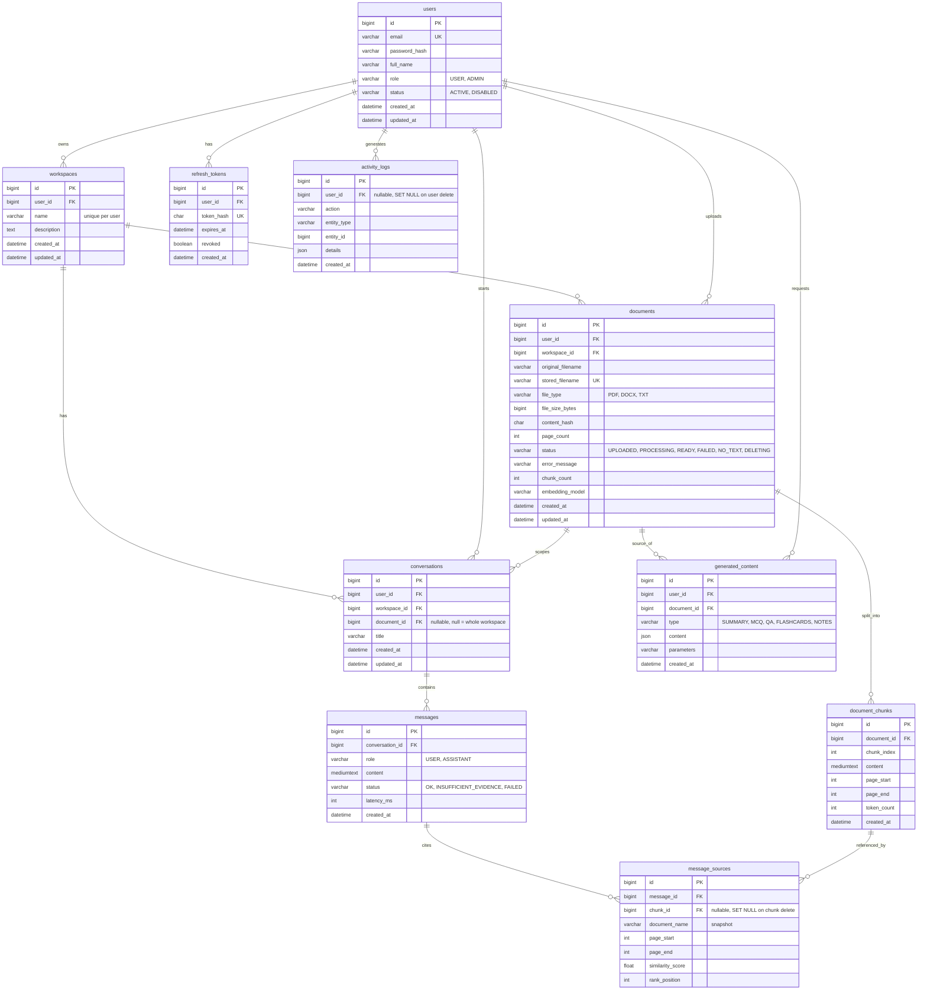

# DocuMind AI: MySQL ER Diagram

Version: 0.1 (matches `database/schema.sql`)
Related documents: [ARCHITECTURE.md](ARCHITECTURE.md), [SRS.md](SRS.md)

Spring Boot owns this schema and applies it with Flyway migrations. FastAPI writes only to `document_chunks`.

## Notes

- `refresh_tokens` is a tenth table added to the nine required entities, so logout and refresh-token revocation are real. Only a hash of the token is stored.
- **Key constraints:** `UNIQUE(document_id, chunk_index)` on chunks; `UNIQUE(user_id, name)` on workspaces; `UNIQUE(email)` on users; `UNIQUE(stored_filename)` on documents.
- **Cascades:** deleting a user removes their workspaces, documents and chunks; deleting a workspace removes its documents and conversations. The application also deletes files on disk and Qdrant points (see ARCHITECTURE.md, section 5), because the database cannot do that itself.
- **Indexes:** `documents(user_id, workspace_id, status)`, `documents(workspace_id, content_hash)`, `messages(conversation_id, created_at)`, `activity_logs(user_id, created_at)`, plus a `FULLTEXT` index on `document_chunks.content` for keyword search.
- `documents.content_hash` (SHA-256) detects duplicate uploads inside a workspace.
- **Conversation scope:** `document_id` set means a single document; `NULL` means the whole workspace.
- Vectors are **not** stored in MySQL. They live in Qdrant, which uses `document_chunks.id` as the point ID.
- `message_sources` stores a snapshot of document name and pages so citation history survives document deletion.
